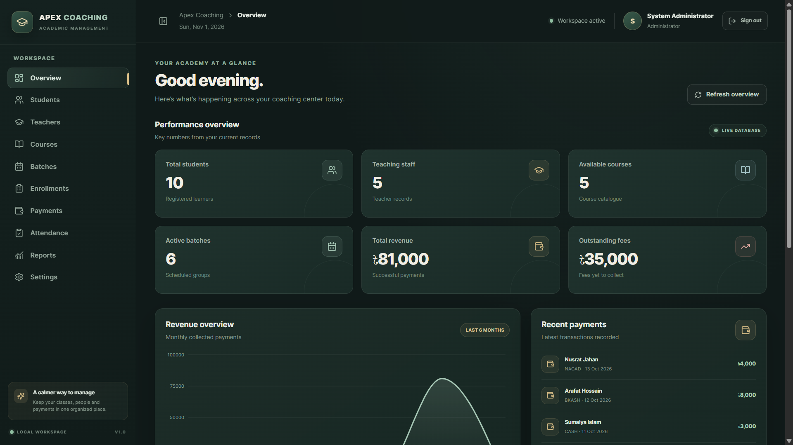

# Apex Coaching Management System

A web-based coaching center management system built as a university project. It provides a centralized dashboard for managing students, teachers, courses, batches, enrollments, payments, and attendance.

## Dashboard Preview



## Features

- **Dashboard:** Overview of students, teaching staff, courses, active batches, revenue, and outstanding fees.
- **Student Management:** Create, view, update, and delete student records.
- **Teacher Management:** Manage teacher information.
- **Course Management:** Organize the courses offered by the coaching center.
- **Batch Management:** Manage batches and their schedules.
- **Enrollment Management:** Register students in batches.
- **Payment Management:** Record and manage student payments.
- **Attendance Management:** Maintain student attendance records.
- **Reports:** View management and financial summaries.
- **Settings:** Access application settings.
- **Admin Login:** Protected access to the management dashboard.

## Tech Stack

| Area | Technology |
|---|---|
| Frontend | React, Vite |
| Styling | Tailwind CSS |
| Backend | Node.js, Express.js |
| Database | Oracle Database 23ai Free |
| Database Driver | `oracledb` |
| Authentication | JSON Web Token (JWT) |

## Run Locally

### Prerequisites

- Node.js and npm
- Oracle Database 23ai Free
- Oracle SQL Developer (recommended for database connection and management)

### 1. Start the Oracle database

Start your local Oracle Database 23ai Free instance and make sure the `FREEPDB1` service is available.

The application uses the following local connection settings:

- Host: `localhost`
- Port: `1521`
- Service: `FREEPDB1`
- Database user: `APEX_CMS_APP`

### 2. Configure the backend environment

Create a `.env` file in the `backend` directory. Use your own local credentials and a strong, private JWT secret:

```env
PORT=5000
NODE_ENV=development
CLIENT_URL=http://localhost:5173

ORACLE_USER=APEX_CMS_APP
ORACLE_PASSWORD=your_oracle_password
ORACLE_CONNECT_STRING=localhost:1521/FREEPDB1

JWT_SECRET=replace_with_a_long_random_secret
JWT_EXPIRES_IN=8h
```

Do not commit `.env` or real credentials to GitHub.

### 3. Install dependencies

From the project root, install the root dependencies:

```bash
npm install
```

If the frontend and backend dependencies have not already been installed, install them in their respective directories:

```bash
cd frontend
npm install
cd ../backend
npm install
cd ..
```

### 4. Start the application

From the project root, run:

```bash
npm run dev
```

This starts the frontend and backend together. Keep the terminal running while using the application.

### 5. Open the application

- **Frontend:** http://localhost:5173/
- **Backend:** http://localhost:5000/
- **Backend health check:** http://localhost:5000/api/health

## Project Structure

```text
apex-coaching-management/
├── frontend/       # React application
├── backend/        # Express API and Oracle database integration
└── package.json    # Root scripts
```

## Project Scope

This application was developed for an academic university project. It demonstrates full-stack application development, CRUD operations, REST API integration, relational database usage with Oracle, and basic admin authentication.

It is intended for local academic demonstration and is not presented as a production-ready system.

## Security Note

Never publish database passwords, administrator credentials, JWT secrets, or `.env` files. Use your own private credentials when running the project.
